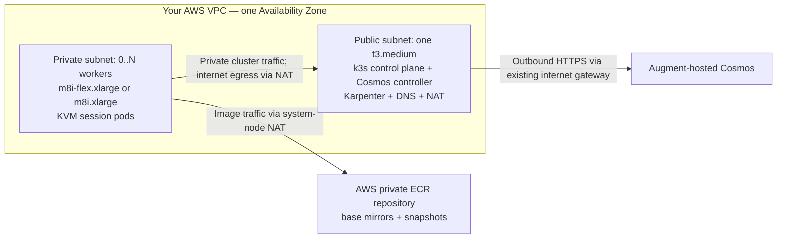
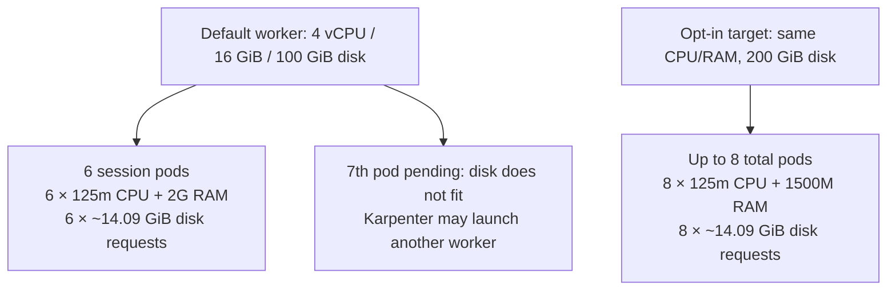

# Cosmos on self-hosted Kubernetes in AWS

A low-footprint pilot using the [official Cosmos Helm chart](https://docs.augmentcode.com/cosmos/guides/self-hosted-k8s#option-2-deploy-with-helm), k3s and self-managed Karpenter. Cosmos stays hosted by Augment; session execution runs in your AWS account.

**Status: experimental, not a production blueprint.** The pilot verified worker provisioning, the AppArmor startup repair, environment builds/snapshots and reduced scheduler reservations. This consolidated installer has offline regression coverage but has not been redeployed end to end from a fresh account. Eight concurrent sessions have not been verified.

## Architecture



- The system node is always on. It has one auto-assigned public IPv4, but no internet-originated SSH or Kubernetes API ingress.
- Workers have no public IP. A new private subnet has its own default route through the system node. Existing public-subnet/main routes are not changed.
- No EKS, managed NAT gateway or separate NAT instance is created. The system node is a single point of failure for management **and** worker internet access.
- Karpenter starts workers for pending sandbox pods and removes empty workers after 120 seconds. Nonempty workers are not consolidated; active sessions are not proactively repacked.
- NAT forwards internet TCP 80/443 only. VPC-local access follows local routes; VPC DNS is used. Git-over-SSH and custom internet ports need reviewed firewall/security-group changes.
- Administration uses AWS Systems Manager (SSM). Snapshots remain in ECR when workers scale to zero.

## Worker sizing: about six slots, eight as an unverified target

The default worker is **`m8i-flex.xlarge` (4 vCPU, 16 GiB)**; `m8i.xlarge` is an explicit alternative. Nested virtualization must be advertised by AWS in the chosen Availability Zone. `m8i.large` is not accepted by this installer: it has only 2 vCPU and 8 GiB, below the worker preflight minimum.

A session is normally one Kubernetes sandbox pod containing its microVM. **Scheduler requests are reservations, not actual usage or microVM limits.** The admission policy lowers requests for the `sandbox` container only; it does not change guest vCPU/RAM, burst limits, disk requests or sidecars.

| Profile | CPU request / session | RAM request / session | Worker root disk | Expected packing |
|---|---:|---:|---:|---|
| `default` | `125m` | `2G` (decimal) | 100 GiB gp3 | About **6**, limited by disk in the observed pilot |
| `eight` — opt-in, unverified | `125m` | `1500M` (decimal) | At least 200 GiB gp3 | Target **up to 8** light sessions; not a workload guarantee |

The observed worker had 3.6 allocatable CPUs, about 14.33 GiB allocatable RAM and 87.03 GiB allocatable ephemeral storage. Its sessions each requested about 14.09 GiB ephemeral storage: seven `2G` memory reservations fit, but only six disk reservations. Eight cannot be claimed for that 100-GiB/default configuration.



The eight profile sets matching kubelet/Karpenter `maxPods: 8`, which counts **all pods**, including any DaemonSets. Additional pods, sidecars, larger environments, image-cache growth and filesystem overhead can reduce session capacity. Eight busy 2-vCPU guests cannot each receive two physical CPUs simultaneously; memory pressure can also kill workloads. Measure real usage before increasing density. New pods receive the policy; existing pods are not resized.

## Container images and snapshots

| Artifact | Location / pin |
|---|---|
| Official Cosmos Helm chart | `oci://dist.augmentcode.com/helm/cosmos`, version `0.20261024.12931` |
| Cosmos controller + sandbox runtime | `dist.augmentcode.com/cosmos/cosmos-sh@sha256:d912bdfc72b9c4b6b73f814a0d171f6612211f54df1c5a8746a0a6945ea8ff14` |
| Starting environment image | `dist.augmentcode.com/cosmos/cosmos-default:latest` — select in Cosmos; this tag is mutable |
| Private base mirrors + environment/session snapshots | `<account>.dkr.ecr.<region>.amazonaws.com/<stack-name>-snapshots` |
| Karpenter | `oci://public.ecr.aws/karpenter/karpenter`, version `1.15.1` |
| Host / cluster tools | Canonical Ubuntu 24.04 amd64 AMI; k3s `v1.37.1+k3s1`; Helm `v3.22.0` |

The installer resolves and records the regional Ubuntu AMI; use `--ami-id` to pin one. Runtime image and chart versions are independent: **do not use the Helm chart version as a container tag**. Controller/sandbox images are digest-pinned. k3s/Helm downloads are checksum-verified; chart signatures are not independently verified.

ECR snapshot tags are opaque identifiers, not necessarily Cosmos session IDs. Snapshots are private and retained across worker termination; track their repository/tag when diagnosing restore failures. An environment snapshot created on a different provider is not automatically available here: create/rebuild the environment from its base image on this provider rather than reusing a missing snapshot reference.

## Replicate from AWS CloudShell

### 1. Prerequisites

- Ask Augment to enable self-hosted Kubernetes for your tenant if necessary. Create an enabled **Sandbox Provider** in Cosmos and note its exact slug, e.g. `my-k8s-0`.
- Create a Cosmos service account/API token with the access required by the official guide. Keep the token in a password manager until the hidden installer prompt. Never put credentials in command arguments, files committed to Git or chat.
- Use a non-root AWS identity in CloudShell with approved EC2, CloudFormation, IAM/PassRole, ECR, SSM, networking and KMS permissions. This provisions billable resources. Review the generated IAM policy before applying; the system role has broad regional EC2 launch permissions and is not a production tenant-isolation boundary.
- Have an existing default VPC, usable public subnet and attached internet gateway in `us-east-1a`, free subnet address space, VPC DNS, suitable NACLs, regional EC2 quotas and nested-virtualization-capable worker capacity. CloudShell needs Python 3 and `boto3` (normally included).
- Provide outbound access for Cosmos, AWS APIs, registries, GitHub releases, Helm and Ubuntu package downloads. Connected networks must not overlap the k3s pod/service CIDRs `10.42.0.0/16` / `10.43.0.0/16`.

### 2. Download and preview — no AWS writes

Run from CloudShell, using an approved repository revision:

```bash
git clone https://github.com/augmentcode/integrations.git
cd integrations/self-hosted-k8s-AWS
sha256sum -c SHA256SUMS
bash deploy.sh --provider my-k8s-0
```

This discovers the default VPC/public subnet, selects a free worker CIDR and writes `infrastructure.generated.json`. It does **not** create resources. Review the account, AZ, AMI, network, security groups, IAM and generated template. Check your own IPAM/on-prem reservations: discovery cannot see every connected network or prove effective permissions, quotas or real capacity.

Optional overrides: `--region`, `--availability-zone`, `--vpc-id`, `--system-subnet-id`, `--worker-subnet-cidr`, `--ami-id` and `--worker-instance-types`. No VPC/subnet identifiers are required when default discovery succeeds. US gateway defaults to `gw.cosmos.augmentcode.com:443`; for another region/tenant, confirm the gateway with Augment and use `--portal-address`.

### 3. Apply the reviewed configuration

```bash
bash deploy.sh --provider my-k8s-0 --apply
```

Type the requested `DEPLOY <account-id>` confirmation. The script privately prompts for the Cosmos token only if the stack's SSM parameter is absent. It stores the token as an SSM SecureString, not in shell arguments or Helm values.

CloudFormation creates the system EC2 instance, private worker subnet/routes, IAM roles, security groups and ECR repository. SSM delivers compressed, **nonsecret** bootstrap assets/configuration; the node fetches credentials through its IAM role. Progress reports infrastructure, SSM registration and bootstrap status. No session/build is started automatically.

For an explicit eight-session **target**, preview and then apply with the same options:

```bash
bash deploy.sh --provider my-k8s-0 --session-profile eight --worker-disk-gb 200
bash deploy.sh --provider my-k8s-0 --session-profile eight --worker-disk-gb 200 --apply
```

Keep `deployment-state.json` in CloudShell for recovery. `--apply --resume` is only for an existing completed stack with matching inputs and no active bootstrap command; it is not an upgrade/migration path from older bundles or a way to change profiles. Closing CloudShell does not terminate resources or remote commands. A failed bootstrap leaves resources running for diagnosis and billing continues.

### 4. Create an environment and verify a session

In Cosmos, select this sandbox provider when creating a new environment. Start from `dist.augmentcode.com/cosmos/cosmos-default:latest`, build it and wait for success; then start a session using that environment. Keep this step explicit because it can launch paid workers.

Use **EC2 → Instances → system instance → Connect → Session Manager** for cluster checks. In that SSM shell:

```bash
sudo k3s kubectl get nodes -o wide
sudo k3s kubectl -n cosmos-ctrl get pods
sudo k3s kubectl -n cosmos-sb get pods -o wide
sudo k3s kubectl get nodeclaims
```

Check that the worker is `Ready`, the sandbox starts, the build completes and snapshot restore works after a worker is replaced. Inspect a sandbox's effective requests, rather than assuming the policy ran:

```bash
sudo k3s kubectl -n cosmos-sb get pods -o 'custom-columns=NAME:.metadata.name,CPU:.spec.containers[?(@.name=="sandbox")].resources.requests.cpu,RAM:.spec.containers[?(@.name=="sandbox")].resources.requests.memory,DISK:.spec.containers[?(@.name=="sandbox")].resources.requests.ephemeral-storage'
```

After sessions/builds end, confirm no sandbox pods remain and empty workers disappear. Snapshot retention is independent of worker scale-down. Do not delete failed pods before collecting their status; do not share raw logs, Secret objects, SSM outputs or kubeconfig without checking them for credentials.

## Files and operational notes

| File | Purpose |
|---|---|
| `deploy.sh`, `deploy.py` | CloudShell entrypoint, discovery/preflight, CloudFormation plan/apply, SSM delivery and progress/recovery |
| `system-bootstrap.sh` | Installs NAT, k3s and Helm, then configures the cluster |
| `worker-bootstrap.sh` | Enables KVM, loads executable-scoped AppArmor policy and joins k3s |
| `configure-cluster.py` | Karpenter/Cosmos Helm values, private worker pool, reservation admission policy and secret-refresh timer |
| `configure-nat.py` | Owned firewall chains and persistent system-node NAT |
| `refresh-secrets.py` | Refreshes mounted portal/ECR credentials through node IAM; ECR refresh every four hours |
| `test_deploy.py`, `test_nat.py`, `test_profiles.py` | Offline regression tests; no AWS provisioning |
| `SHA256SUMS` | Download integrity checks, not an independently signed release |

Worker bootstrap installs `/etc/apparmor.d/cosmos-sandbox` for `/usr/local/opt/cosmos/bin/sb`, allowing its user namespace creation without disabling Ubuntu's global AppArmor restriction. It uses an executable-scoped **unconfined** profile, not a new sandbox-hardening boundary; review this exception before production. A differing existing profile is not overwritten.

The reservation policy is cluster-scoped but matches only newly created `cosmos-sb` pods with this installation/provider's labels and a `sandbox` container. It relies on the pinned k3s version's `admissionregistration.k8s.io/v1` mutating admission policies. No global replacement of all pod requests is performed.

Retain the system node's private IP and SSM SecureStrings during recovery. Workers have agent-only join credentials, not the k3s server token or direct ECR IAM access. Guests must not receive host/registry credentials. You own patching, monitoring, backup, firewall review and credential rotation.

**Costs and cleanup:** the system instance, public IPv4, EBS and retained ECR storage remain billable even with zero workers. Active workers add EC2/EBS and transfer costs. `--worker-max-vcpu` is an eventually consistent scaling limit, not a strict spending cap. There is no automatic teardown: Karpenter-created workers, externally created SSM parameters and retained ECR data need separate review before deleting the CloudFormation stack. Never delete snapshots still referenced by environments/sessions.

Run offline checks without AWS credentials or writes:

```bash
python3 -m unittest -v test_deploy test_nat test_profiles
bash -n deploy.sh system-bootstrap.sh worker-bootstrap.sh
```
