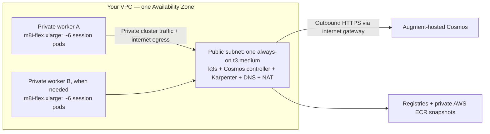

# Cosmos on self-hosted Kubernetes in AWS

Run Cosmos sessions in your AWS account using the [official Helm chart](https://docs.augmentcode.com/cosmos/guides/self-hosted-k8s#option-2-deploy-with-helm), k3s and self-managed Karpenter. Cosmos itself stays hosted by Augment.

**Experimental pilot:** worker provisioning, sandbox startup and builds/snapshots were verified; the consolidated installer has not been redeployed end to end from scratch.

## Architecture



- **No EKS or managed NAT gateway.** The system node also provides NAT; it is a single point of failure.
- Only the system node has a public IPv4. No public SSH/API ingress; administration uses AWS Systems Manager (SSM). Worker internet egress is TCP 80/443 only.
- Karpenter adds workers for pending pods and removes empty workers after 120 seconds. Workers scale to zero; ECR snapshots persist. Active sessions are not repacked.

## Capacity: about 6 session pods per worker

| Setting | Default |
|---|---|
| Worker | `m8i-flex.xlarge`: 4 vCPU, 16 GiB RAM; `m8i.xlarge` is an alternative |
| Worker disk | 100 GiB gp3 |
| Sandbox CPU / RAM requests | `125m` / `2G` (decimal) |
| Observed disk request per session | ~14.09 GiB |

**Disk limits packing to six:** the observed worker had ~87.03 GiB allocatable ephemeral storage, fitting six ~14.09-GiB reservations. A seventh such pod needs another worker. This is a capacity calculation, not a six-session load-test result or a hard pod-count limit.

Requests are scheduler reservations, not dedicated resources. Guest limits remain unchanged; busy sessions compete for CPU/RAM, and larger environments or extra pods can reduce capacity. `m8i.large` is below this installer's minimum worker size.

## Container images

| Image | Location |
|---|---|
| Controller + sandbox runtime | `dist.augmentcode.com/cosmos/cosmos-sh` |
| Starting environment | `dist.augmentcode.com/cosmos/cosmos-default:latest` |
| Private mirrors + snapshots | `<account>.dkr.ecr.<region>.amazonaws.com/<stack-name>-snapshots` |

The scripts manage component versions. Ubuntu 24.04 amd64's regional AMI is discovered automatically; `--ami-id` can override it.

## Deploy from AWS CloudShell

### 1. Prepare

- In Cosmos, enable self-hosted Kubernetes with Augment if needed; create an enabled **Sandbox Provider** and a service-account API token. Use your provider's exact slug below instead of `my-k8s-0`.
- Use a non-root AWS identity with approved CloudFormation, EC2, IAM/PassRole, ECR, SSM and KMS permissions. CloudShell needs Python 3 and `boto3`.
- Have a default VPC/public subnet with an internet gateway, DNS/HTTP(S) egress, free subnet space and nested-virtualization-capable worker capacity. Defaults are `us-east-1` / `us-east-1a`.

### 2. Clone the code and preview

In CloudShell, clone the repository below. For review before this PR is merged, add `--branch nico/self-hosted-k8s-aws` to the clone command.

```bash
git clone https://github.com/augmentcode/integrations.git
cd integrations/self-hosted-k8s-aws
bash deploy.sh --provider my-k8s-0
```

Preview makes **no AWS writes**. It discovers the network, selects a private worker CIDR and writes `infrastructure.generated.json`. Review the account, network, IAM and resources; check CIDRs against your IPAM/connected networks. No VPC/subnet IDs are needed when discovery succeeds; `--help` lists overrides. For a non-US Cosmos gateway, confirm the address with Augment and use `--portal-address`.

### 3. Apply

```bash
bash deploy.sh --provider my-k8s-0 --apply
```

Confirm `DEPLOY <account-id>`. When prompted, enter the Cosmos token privately; it is stored in SSM as a SecureString. **Never put tokens in commands or chat.** CloudFormation provisions infrastructure; SSM bootstraps the system node. Existing public-subnet/main routes are unchanged. No build/session is started automatically.

### 4. Build and verify

In Cosmos, create an environment on this provider from `dist.augmentcode.com/cosmos/cosmos-default:latest`, build it, then start a session. This can launch paid workers. Rebuild from the base image rather than reusing a snapshot unavailable on this provider.

Connect to the system instance through **EC2 → Connect → Session Manager**:

```bash
sudo k3s kubectl get nodes -o wide
sudo k3s kubectl -n cosmos-ctrl get pods
sudo k3s kubectl -n cosmos-sb get pods -o wide
```

Check worker readiness, successful build/startup and snapshot restore. After sessions/builds end, empty workers should disappear. Do not share raw logs, Secret objects or kubeconfig without checking for credentials.

## Scripts and operations

- **Entry:** `deploy.sh` / `deploy.py`; **node setup:** `system-bootstrap.sh` / `worker-bootstrap.sh`; **cluster setup:** `configure-cluster.py`; **NAT:** `configure-nat.py`; **portal/ECR credentials:** `refresh-secrets.py` (refresh every four hours).
- Requests are adjusted only for new, matching sandbox pods. Worker bootstrap uses an executable-scoped **unconfined** AppArmor exception without disabling Ubuntu's global restriction. Review this and the broad regional EC2 permissions before production.
- Keep `deployment-state.json`. `--apply --resume` requires matching inputs/a completed stack and is not a migration tool. Failed deployment or closing CloudShell does not stop billing.
- The system node, public IPv4, EBS and ECR remain billable at zero workers. Scaling limits are not hard spending caps. Teardown needs separate review of Karpenter workers, SSM parameters and retained ECR snapshots; do not delete snapshots still in use.

Offline checks (no AWS writes):

```bash
python3 -m unittest -v test_deploy test_nat test_profiles
bash -n deploy.sh system-bootstrap.sh worker-bootstrap.sh
```
